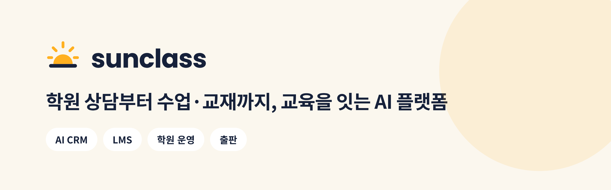

<picture>
  <source media="(prefers-color-scheme: dark)" srcset="./assets/banner-dark.png">
  
</picture>

 

**썬클래스(sunclass)** 는 학원을 위한 교육 기술을 만들어요.
이름처럼 **햇살 드는 교실** — 원장님은 운영을 가볍게, 학생은 배움을 따뜻하게 만나도록.

코딩·AI 학원 **C&AI Institute** 를 직접 운영하며 겪은 문제에서 시작했어요.

 

## 🔆 서비스

| | 서비스 | 하는 일 |
|:---:|---|---|
| ☎️ | **AI CRM** | AI가 24시간 전화·카카오톡 문의를 받고, 상담 내용은 자동으로 학부모 기록에 쌓여요. 예약·설명회 관리, 문의·등록 리포트 |
| 🏫 | **학원 운영** | 학생·반·시간표·출결·수강권·수납·간편장부까지 한곳에서 |
| 💻 | **LMS** | 엔트리·Python·C++ 코딩, 자동 채점, 숙제, 학원 PC 실시간 수업, 학부모 리포트 |
| 📚 | **출판** | 수업과 이어지는 교재와 학습서 |

> 학원 상담이 그대로 데이터가 됩니다.

 

## 🛠 함께 쓰는 기술

  
  
  
  
  
  
  

 

## 🌱 일하는 방식

- **입력하지 않아도 되게** — AI가 할 수 있는 일은 AI가, 사람은 확인만
- **원본은 하나** — 같은 정보를 두 번 옮겨 적지 않게
- **학원 데이터는 학원 것** — 학원마다 데이터를 분리하고, 필요한 정보만 다뤄요

 

  

© sunclass · Incheon, South Korea

